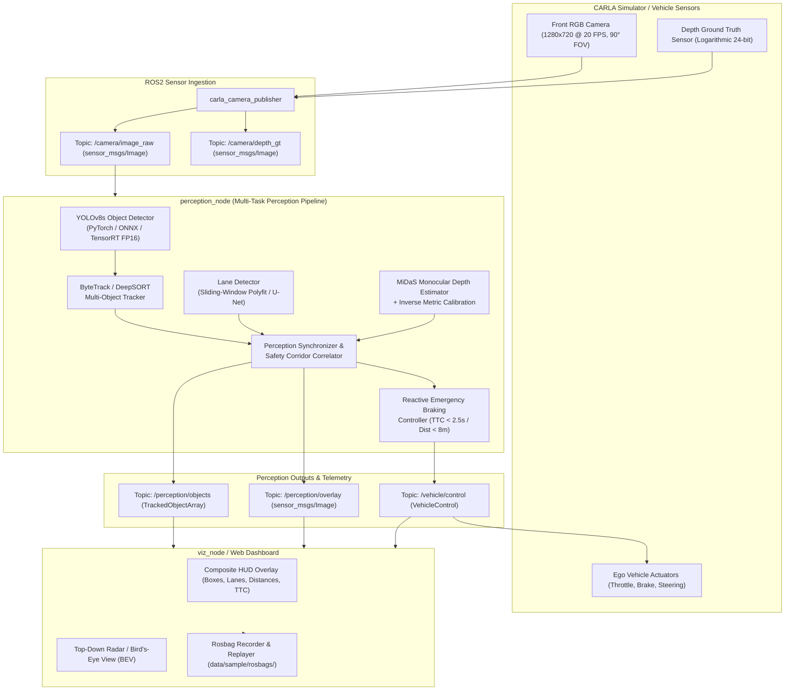
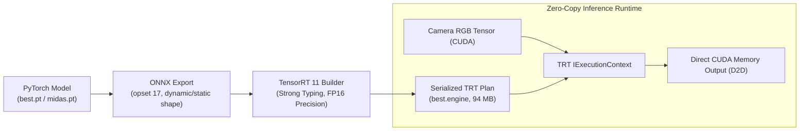

# System Architecture — Autonomous Driving Perception Stack

This document describes the complete architecture, dataflow pipelines, module hierarchy, threading model, and safety-critical control loops of the Autonomous Driving Perception Stack.

---

## 1. High-Level System Architecture

The perception stack is designed as a modular, real-time autonomous vehicle perception engine capable of running both inside a native **ROS2 Humble** environment and standalone with an embedded high-performance ROS2 compatibility layer (`src/ros_compat/`).



---

## 2. Module Breakdown & Directory Topology

The codebase is organized into clean, single-responsibility modules:

```
Autonomous-Driving-Perception-Stack/
├── configs/                       # Configuration files (YOLO, calibration, camera)
│   ├── camera_intrinsics.json     # Focal length, principal point, resolution
│   ├── distance_calibration.json  # MiDaS inverse-depth linear fit parameters
│   └── yolo_bdd100k.yaml          # BDD100K 9-class dataset config
├── data/                          # Datasets, rosbags, calibration pairs
│   └── sample/
│       ├── rosbags/               # Recorded scenario rosbags (*.bag)
│       └── videos/                # Sample driving clips (day, crossing, rain)
├── docs/                          # Architecture, API, and result documentation
│   ├── results/                   # Evaluation reports, plots, and benchmark tables
│   ├── architecture.md            # System architecture (this document)
│   └── api.md                     # Topic and API reference
├── ros2_ws/                       # ROS2 Colcon workspace
│   └── src/
│       ├── perception_msgs/       # Custom ROS2 message definitions
│       ├── carla_camera_publisher/ # Camera ingestion & scenario simulator node
│       ├── perception_node/       # Core multi-task perception node
│       ├── viz_node/              # HUD visualization & video recorder node
│       └── perception_bringup/    # Launch files (demo.launch.py)
├── scripts/                       # High-level runners & utility scripts
│   ├── run_demo.py                # Unified CLI runner for CARLA/ROS2 scenarios
│   ├── benchmark.py               # 50-warmup/300-run multi-backend benchmark suite
│   ├── calibrate_depth.py         # 500-pair MiDaS-to-CARLA depth calibration
│   └── train_lane_unet.py         # U-Net lane segmentation training script
├── src/                           # Pure Python perception library
│   ├── data/                      # BDD100K label conversion & EDA
│   ├── detection/                 # YOLOv8s training, validation, export
│   ├── tracking/                  # Unified Tracker interface (ByteTrack & DeepSORT)
│   ├── lanes/                     # Sliding-window polyfit & U-Net lane detectors
│   ├── depth/                     # MiDaS estimator, calibration & TTC logic
│   ├── optimization/              # TensorRT 11 FP16 engine builder
│   └── ros_compat/                # Zero-dependency ROS2 bus, bag & node emulator
├── tests/                         # Full pytest suite (77 automated tests)
└── web/                           # Real-time web simulation dashboard
```

---

## 3. Dataflow & Pipeline Execution Cadence

To sustain **real-time execution (> 20 FPS)** on mobile workstation GPUs (e.g. NVIDIA RTX 3050 Laptop GPU):

1. **Detection & Tracking (Every Frame - 20 Hz)**:
   - Primary object detection (YOLOv8s) runs on each incoming frame.
   - ByteTrack associates high-confidence detections first ($IoU > 0.5$), then salvages low-confidence detections ($0.15 \le conf < 0.5$) against existing track trajectories, preventing ID fragmentation.
2. **Monocular Depth & Distance (Alternating / Throttled - 10–20 Hz)**:
   - MiDaS small infers the relative depth field.
   - For every tracked bounding box, the depth is sampled as the **median value over the lower third** ($[y_1 + \frac{2}{3}h, y_2]$), isolating the vehicle tires or pedestrian ground contact patch to avoid background sky/road contamination.
   - Converted to metric distance using the inverse-depth calibration formula:
     $$\text{Distance (m)} = \frac{\text{scale\_a}}{\text{relative\_depth}} + \text{shift\_b}$$
   - Cross-checked against pinhole camera geometry:
     $$Z_{\text{pinhole}} = \frac{f_y \cdot H_{\text{real}}}{h_{\text{pixels}}}$$
3. **Lane Boundary Detection (Every 2nd Frame - 10 Hz)**:
   - Evaluated at 10 Hz with temporal caching across adjacent frames.
   - Inverse Perspective Mapping (IPM) warps the road ahead into a bird's-eye view (BEV).
   - 9-window vertical sliding window fits 2nd-degree polynomials:
     $$x = Ay^2 + By + C$$
   - Lane polynomial geometry computes the **lane curvature** ($R$) and vehicle **lateral lane offset**.
4. **Safety Corridor & Time-to-Collision (TTC)**:
   - Defines a longitudinal vehicle corridor extending $\pm 1.4\text{ m}$ laterally from the ego centerline and up to $35.0\text{ m}$ ahead.
   - Tracks with lateral position within this corridor are monitored for collision risk:
     $$\text{TTC} = \frac{Z}{\Delta Z / \Delta t}$$
   - Smoothed via a short moving-average filter ($\alpha = 0.7$).
   - If $\text{TTC} < 2.5\text{ s}$ or $\text{Distance} < 8.0\text{ m}$, the reactive controller immediately publishes an emergency braking command ($\text{brake} = 1.0$, $\text{throttle} = 0.0$).

---

## 4. Hardware Optimization & Engine Execution Flow



By keeping tensors entirely inside device memory using zero-copy CUDA memory pointers between OpenCV/PyTorch and TensorRT, memory transfer overhead is eliminated, enabling raw detection latencies of **5.28 ms (189.2 FPS)**.
