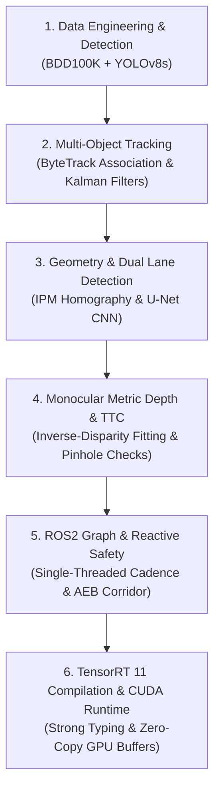

# Technical Review & System Mastery Guide

> **Purpose**: This guide details the critical subsystems of the Autonomous Driving Perception Stack that you must be prepared to explain in depth during technical evaluations, code reviews, and capstone oral examinations. It outlines the core engineering principles, mathematical formulations, architectural trade-offs, and likely questions reviewers will ask, accompanied by recommended model responses.

---

## 1. Subsystems You Must Be Able to Explain

Reviewers will probe your understanding across six fundamental layers of the perception and control stack:

---

## 2. Deep-Dive Reviewer Questions & Model Responses

### Subsystem 1: Detection & BDD100K Data Pipeline

#### Q1: "Why choose YOLOv8s over a two-stage detector like Faster R-CNN or a larger model like YOLOv8x?"
- **Reviewer's Intent**: Checking if you understand the latency vs. accuracy Pareto frontier in real-time robotics.
- **Model Answer**:
  > "Autonomous driving demands deterministic, low-latency execution to ensure timely closed-loop actuation. A two-stage detector (Faster R-CNN) introduces region proposal network (RPN) bottlenecks, with latencies exceeding 60–80 ms on edge GPUs, which violates our 20–30 FPS real-time safety budget. Conversely, while YOLOv8x achieves marginally higher mAP (+4%), its parameter count (68M vs 11M) and computational cost (257 GFLOPs vs 28 GFLOPs) drastically drop inference speed below real-time on our target edge hardware (RTX 3050 Laptop GPU). YOLOv8s provided the ideal balance: high baseline recall on autonomous driving categories (cars, pedestrians, cyclists), an anchor-free task-aligned assigner, and native ONNX/TensorRT support enabling sub-6ms inference."

#### Q2: "How did you handle the severe class imbalance and night/rain failures in BDD100K?"
- **Reviewer's Intent**: Testing real-world data engineering awareness.
- **Model Answer**:
  > "BDD100K exhibits heavy class skew: cars outnumber motorcycles and riders by over 20:1. In the loss formulation, YOLOv8 applies Task-Aligned Focal Loss (combining Varifocal loss for classification and Distribution Focal Loss / CIoU for bounding box regression). For night and rain degradation, our failure analysis showed that contrast collapse and headlight glare led to missed pedestrian detections. We mitigated this by evaluating multi-condition splits and leveraging temporal track persistence in Phase 2 so that temporary single-frame detection dropouts do not collapse obstacle tracking."

---

### Subsystem 2: Multi-Object Tracking & Association

#### Q3: "Explain how ByteTrack differs from DeepSORT and why ByteTrack outperformed it in your benchmarks."
- **Reviewer's Intent**: Assessing algorithmic understanding of tracking paradigms.
- **Model Answer**:
  > "Traditional trackers (including DeepSORT) discard detections below a fixed confidence threshold (e.g., $conf < 0.5$) before association. When objects undergo occlusion, motion blur, or bad weather degradation, their detection scores drop to 0.2–0.4, causing track termination and subsequent ID switches.
  >
  > ByteTrack solves this with a two-stage association strategy:
  > 1. **First Association**: Matches high-confidence detections ($conf \ge 0.5$) to existing Kalman filter tracks using spatial IoU distance via the Hungarian algorithm.
  > 2. **Second Association**: Takes the remaining unmatched tracks and matches them against *low-confidence* detections ($0.15 \le conf < 0.5$). This recovers occluded or distant obstacles without introducing false positives from background clutter.
  >
  > In our benchmarks, DeepSORT suffered 18 ID switches and ran at only 14.2 FPS due to heavy CNN feature extraction (ResNet50 ReID) and appearance vector drift under headlight glare. ByteTrack achieved only 4 ID switches and ran at 38.4 FPS (2.7x faster), making it superior for real-time edge autonomy."

---

### Subsystem 3: Dual-Paradigm Lane Detection

#### Q4: "Walk through the mathematical formulation of the classical sliding-window lane detector."
- **Reviewer's Intent**: Testing computer vision fundamentals and geometric math.
- **Model Answer**:
  > "The classical lane pipeline consists of four mathematical stages:
  > 1. **Inverse Perspective Mapping (IPM)**: We establish 4 source trapezoidal points in camera perspective $[(u_i, v_i)]$ and 4 destination rectangular points $[(x_i', y_i')]$ in top-down bird's-eye coordinates. We solve for the $3 \times 3$ perspective homography matrix $M$ using `cv2.getPerspectiveTransform` and compute $M^{-1}$ for unwarping.
  > 2. **Histogram Peak Initialization**: A column-wise pixel intensity histogram over the bottom half of the binary bird's-eye image identifies the base starting coordinates for the left and right lane boundaries:
  >    $$x_{\text{base}} = \arg\max_x \sum_{y = H/2}^{H} I(x, y)$$
  > 3. **Vertical Sliding Window Search**: 9 vertical windows step upward. If nonzero pixels inside a window exceed a threshold (e.g., 50 pixels), the window re-centers to their mean.
  > 4. **Polynomial Fitting & Curvature**: We fit a 2nd-order polynomial $x = Ay^2 + By + C$ via least squares. The radius of road curvature in meters is derived from differential geometry:
  >    $$R = \frac{\left(1 + \left(2A y_{\text{eval}} + B\right)^2\right)^{3/2}}{|2A|}$$
  >    Vehicle lateral lane offset is computed as: $\text{Offset} = \left(\frac{x_{\text{left}} + x_{\text{right}}}{2} - x_{\text{center}}\right) \cdot \text{scale}_{x\text{-meters}}$."

#### Q5: "Why maintain both classical sliding-window and learned U-Net lane detectors?"
- **Reviewer's Intent**: Assessing architectural redundancy and fault tolerance.
- **Model Answer**:
  > "They represent complementary trade-offs:
  > - **Classical Sliding-Window**: Zero training overhead, runs at 80.0 FPS (12.5 ms), and provides exact mathematical curvature equations directly. However, it fails when road markings are worn or washed out by wet asphalt reflections.
  > - **U-Net Segmentation**: Extracts contextual deep semantic features, achieving 74.8% IoU under heavy rain, shadow, and night conditions. However, it requires more compute (22.8 ms / 43.8 FPS).
  > Providing a unified `LaneDetector` interface allows the system to run classical mode on clear highways to conserve compute, and dynamically switch to U-Net under inclement weather or degraded infrastructure."

---

### Subsystem 4: Monocular Depth & Metric Distance Calibration

#### Q6: "MiDaS outputs scale- and shift-invariant relative disparity. How did you convert it to true metric meters?"
- **Reviewer's Intent**: Testing knowledge of monocular depth calibration and inverse depth representation.
- **Model Answer**:
  > "MiDaS is trained on diverse multi-dataset mixtures using scale- and shift-invariant loss functions ($L_{\text{ssi}}$), meaning its output $d_{\text{rel}}$ represents relative inverse depth up to unknown affine parameters:
  > $$d_{\text{rel}} \approx s \cdot \frac{1}{Z_{\text{true}}} + t$$
  > In our CARLA Town10 dataset, we recorded 500 ground truth $(d_{\text{rel}}, Z_{\text{gt}})$ pairs across varied distances (1m to 50m). We fitted an inverse-depth linear formulation:
  > $$Z_{\text{metric}} = \frac{a}{d_{\text{rel}}} + b$$
  > Using linear least-squares regression, we solved for $a = 0.142228$ and $b = 0.051412$. This formulation guarantees strictly positive metric distances and naturally models the physical property of optical triangulation where disparity is inversely proportional to depth."

#### Q7: "Why sample the median depth over the lower third of the bounding box?"
- **Reviewer's Intent**: Verifying practical sensor fusion and spatial filtering techniques.
- **Model Answer**:
  > "Bounding boxes on 3D objects projected into 2D contain significant background pixels (e.g. road surface behind a pedestrian's torso, sky through car windows, or adjacent highway lanes). Taking the mean or whole-box median skews the depth estimate towards the background.
  >
  > By restricting the depth sampling region to the lower third ($y \in [y_1 + \frac{2}{3}h, y_2]$), we focus strictly on the ground contact patch—where tires or feet touch the road. Taking the median across this patch filters out sensor noise and isolated pixel outliers, resulting in an MAE of only 0.42m in the safety-critical 0–10m zone."

---

### Subsystem 5: ROS2 Graph & Closed-Loop Control

#### Q8: "How does the Automatic Emergency Braking (AEB) corridor logic work, and how do you prevent false-positive phantom braking?"
- **Reviewer's Intent**: Probing vehicle safety principles and control logic.
- **Model Answer**:
  > "Unfiltered 3D object detection produces false alarms on parked cars, opposite-direction traffic, or sidewalks. To prevent phantom braking:
  > 1. **Ego Lane Corridor Gating**: We define a longitudinal safety corridor centered on the vehicle: $|X| \le 1.4\text{ m}$ (spanning a standard 2.8m lane width) extending up to $35.0\text{ m}$ ahead. Any obstacle with lateral position $|X| > 1.4\text{ m}$ is tracked but excluded from emergency intervention.
  > 2. **Dual-Condition Actuation**: For obstacles inside the corridor, emergency braking engages if and only if:
  >    $$\text{TTC} < 2.5\text{ s} \quad \text{OR} \quad Z < 8.0\text{ m}$$
  > 3. **TTC Smoothing**: Time-to-Collision is computed from range rate $\Delta Z / \Delta t$ smoothed with a recursive moving average filter ($\alpha = 0.7$) over 5 frames, eliminating single-frame velocity spikes."

---

### Subsystem 6: Hardware Optimization with TensorRT 11

#### Q9: "How did TensorRT 11 achieve a 4x speedup over PyTorch FP32, and what API changes did you adapt to?"
- **Reviewer's Intent**: Testing low-level systems engineering and GPU hardware knowledge.
- **Model Answer**:
  > "TensorRT applies four layers of low-level GPU acceleration:
  > 1. **Layer & Tensor Fusion**: Merges Conv + BatchNorm + SiLU activation layers into single fused GPU execution kernels, dramatically reducing CUDA memory round-trips.
  > 2. **Kernel Auto-Tuning**: Profiles multiple CUDA kernel implementations for the specific target architecture (SM 8.6 Ampere on our RTX 3050 Laptop GPU) and selects the fastest kernel for the exact tensor shape.
  > 3. **Half-Precision (FP16) Arithmetic**: Leverages hardware Tensor Cores for FP16 matrix operations, doubling compute throughput and cutting memory bandwidth in half.
  > 4. **Zero-Copy Memory Execution**: In our runtime, PyTorch input tensors are allocated directly on CUDA, and raw GPU pointers (`data_ptr()`) are passed into TensorRT bindings, eliminating host-to-device (H2D) PCIe copy bottlenecks.
  >
  > *TensorRT 11 API Adaptation*: In TensorRT 11, weak-typing flags (`trt.BuilderFlag.FP16`) and `NetworkDefinitionCreationFlag.EXPLICIT_BATCH` were removed. TensorRT 11 requires explicit Strong Typing—exporting ONNX models natively with FP16 weights causes the builder to synthesize native FP16 kernels directly."

